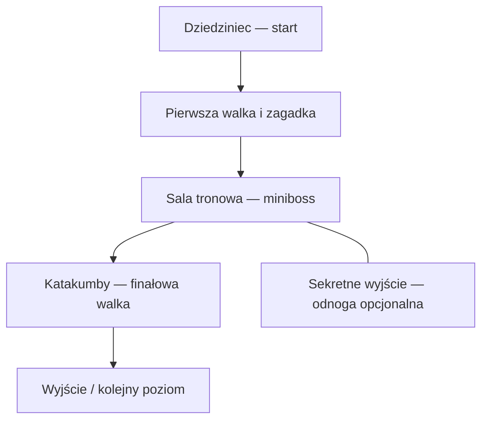

# Shadows of the Forsaken

Przygodowa gra akcji z eksploracją i zagadkami środowiskowymi w mrocznym, upadłym królestwie. Projekt powstaje w Unity i ma **implementować grę oraz poziom opisane w [Shadows of the Forsaken.docx](Shadows%20of%20the%20Forsaken.docx)**.

> **DOCX jest nadrzędną specyfikacją projektu** — obejmuje tekst, referencje graficzne, flow chart i mapę 2D. README opisuje zakres i stan realizacji, ale nie zastępuje dokumentu. W razie rozbieżności obowiązuje DOCX albo późniejsza, wyraźna decyzja właściciela projektu. Prototypy techniczne są etapami realizacji, nie alternatywnym pomysłem na grę.

Zapisany układ sceny porównano z mapą DOCX: [trzy widoki z edytora i zakres weryfikacji](docs/validation/castle-map-2026-10-01.md). Zgodność topologii nie zastępuje ręcznego odbioru geometrii i nawigacji.

## Bieżący kandydat — 2026-10-17

Nowy [workflow testów metryk tras](.github/workflows/rendered-routes-tests.yml) kompiluje te same źródła C# i wymaga wykonania wszystkich **30 przypadków w 18 metodach**, z zachowaniem TRX i logu. Odrzuca brakujące, pominięte, niezaliczone lub podmienione wyniki. Lokalny rzeczywisty przebieg zaliczył **30/30**; wykonanie tego workflow w GitHub Actions pozostaje niezweryfikowane. To testy czystego C#, odrębne od Unity, renderowania i aktywacji #5.

Opcjonalny [pasywny dziennik audio i zamykania](docs/audio-run-lifecycle-diagnostic.md), źródło **`971ef31`**, zalicza **2/2 regresje Unity oraz obie trasy native i 24/24 warunki kwalifikacji**. Poprawiono rejestrację callbacków testowych i odnajdywanie ukrytego pomocnika zakończenia. Zapis obejmuje oba przebiegi, końcowy odczyt konfiguracji przed quit i **13 rzeczywistych znaczników cyklu życia**. Player sam kończy się kodem 0; runner zapisuje **205,625 s zegara monotonicznego**, bez wykrytego FMOD/no-sound, sekcji awarii natywnej lub pliku awarii. Nie zaobserwowano naturalnych zmian konfiguracji audio; nie jest to dowód odzyskiwania dźwięku ani słyszalnego wyjścia. [Raport](docs/validation/audio-run-lifecycle-2026-10-16.md) zachowuje pierwszy nieudany build, native **23/24** i Unity **1/2**, a następnie niezależnie sprawdzone powtórki. Przyczyna wcześniejszych awarii FMOD/Mono i odbiór człowieka pozostają otwarte; dostawa Release `23b3ac0` zachowuje swój dotychczasowy zakres.

Nowy [ukryty pomiar renderowanych tras](docs/validation/rendered-routes-2026-10-16.md), instrumentacja **`87ddbbf`**, zalicza **2/2 istniejące trasy i 23/23 bramy** w osobnym playerze Development/UTF. Player sam kończy się kodem 0, a host zapisuje **205,688 s zegara monotonicznego**, bez wykrytego FMOD, awarii natywnej lub pliku awarii. Zachowano **23 PNG, sześć pomiarów kadrowania walki i dwa ślady wejścia**; trasy kończą się przy 200 HP w **81,660492 / 121,227158 s**. Callbacki zwykłego renderera, konfiguracja sprzętu, histogramy wizyt i próbki pamięci tworzą odrębny raport inżynierski. Zrzuty, ich jawne renderowanie i przedziały przekraczające te operacje są wyłączone z czasu pomiaru. Pierwsza próba pozostaje odrzucona **22/23** przez niezgodny walidator rzeczywistego formatu `Rect`; poprawkę i powtórkę zapisano oddzielnie. Brakujący licznik Render nie jest zastępowany licznikiem UI Toolkit. Wcześniejsze native10, prezentacja3 i godzina Release zachowują swój zakres, a paczka `23b3ac0` pozostaje aktualną dostawą gry. Wynik nie ustala przyczyny dawnego FMOD/Mono ani odbioru dźwięku lub tempa człowieka.

Nowy [pełny ukryty PlayMode na `801a214`](artifacts/goal-20261014/current-delivery-full-playmode-235-20261016/results.xml), z identycznymi 754 wejściami Unity jak dostawa `90c5c9c`, kończy się wynikiem **234/235**, bez pominięć. Eksploracja wykryła jedną niebezpieczną klatkę kamery przy dolnym połączeniu pierwszego starcia; widok odzyskał bezpieczeństwo w następnej klatce. [Audyt błędu](artifacts/goal-20261014/current-full235-camera-failure-bundle-audit-20261016.json) zachowuje rzeczywisty stan, ostrzeżenie i nieutworzony zrzut wyłączonej kamery. Obie oddzielne trasy osiągają Exit przy 200 HP w **81,52578 / 121,11164 s**. [Zamknięte historie audio](artifacts/goal-20261014/current-full235-audio-union-audit-20261016.json) obejmują cały proces: **4 513 próbek**, stabilne aktywne wyjście LG/NVIDIA i niezmienione stany 19 urządzeń, bez wykrytego FMOD lub błędu natywnego. Ten przebieg nie jest pełnym zielonym wynikiem ani dowodem naprawy przełączania audio.

[Poprawka minimalnej długości widoku](docs/validation/camera-minimum-travel-2026-10-16.md), źródło **`23b3ac0`**, usuwa odtworzoną niespójność: solver wcześniej akceptował skróconą pozycję tuż poniżej własnego minimum, a następna klatka ją odrzucała. Niezmieniona regresja Unity przechodzi z błędu do zaliczenia w zestawie **RED 2/3 → GREEN 3/3**; pełna rodzina kamery zalicza **50/50**, z 118 502 obserwacjami eksploracji, zerem niebezpiecznych klatek i dziewięcioma rzeczywistymi zrzutami. Niezależny audyt sprawdza źródła, importy i 1 127 stabilnych próbek audio obejmujących oba zielone przebiegi. Promień, margines kolizji i próg minimalnej długości pozostają ścisłe. Następny pełny ukryty przebieg tego samego źródła zalicza **238/238 PlayMode**, bez pominięć, przy normalnym zakończeniu i niezależnie sprawdzonych źródłach/importach. Świeże przebiegi tego źródła native zaliczają **10/10 i 14 bram** oraz **3/3 i 21 bram** prezentacji, z niezależnie sprawdzonymi plikami i normalnym zakończeniem. Nowy zwykły Release ma zweryfikowane 199 plików; pierwszy godzinny test ukryty został odrzucony po 2638,313 s przez błąd publikacji diagnostyki `0x80070497` (`ioFailureCount: 1`), przy normalnym wyjściu playera 0 i bez wykrytego FMOD/awarii. Drugie powtórzenie na identycznych plikach i niezmienionych warunkach zalicza niezależny audyt **14 047 migawek / 3600,1228838 s publikacji / 3600,235 s zegara hosta / 20 bram**, z normalnym zamknięciem, niezmienionymi plikami i bez wykrytego FMOD/awarii. W historii audio trasy wystąpiło przełączenie Realtek → HDMI bez wykrytego błędu FMOD. Osobny audyt **18 017 próbek** godzinnego Release potwierdza aktywne HDMI w całym przedziale playera i runnera; zmiana na Realtek następuje po wyjściu. Wyniki nie dowodzą ogólnego odzyskiwania strumienia. Nowa paczka poniżej zawiera tę poprawkę w źródle `23b3ac0`.

[Pasywna diagnostyka konfiguracji audio](docs/validation/audio-configuration-telemetry-2026-10-16.md) dodaje obserwator do jednego istniejącego testu miksera native oraz dwa testy jego cyklu życia. Oba nowe przypadki wykonały się w Unity, a osobny [player native](artifacts/goal-20261014/audio-configuration-telemetry-native-20261016/execution.json) zalicza **1/1 i wszystkie 16 bram**, przy normalnym zakończeniu i niezmienionych plikach. Zachowuje wcześniejsze bramy PCM, błędów i zamknięcia; początkowy/końcowy odczyt wynosi 48 kHz stereo. W tej próbie wystąpiło **zero callbacków zmiany konfiguracji**, więc wynik nie dowodzi odzyskania dźwięku po zmianie urządzenia. Pierwsze wywołanie runnera odrzucono przed startem playera z powodu układu katalogów archiwum narzędzi; osobne wykonanie użyło zweryfikowanego czystego checkoutu. Silnik, ustawienia Windows i progresja nie zostały zmienione.

[Poprawka dokładnej pozycji kamery i jej zachowane dowody](docs/validation/camera-tangent-2026-10-16.md), wcześniejsze źródło gry `0b9e160`, usuwa odtworzony zanik widoku przy piedestale runy. Niezmieniona regresja rzeczywistego Unity przechodzi z **0/1 do 1/1**, z zachowanym marginesem kolizji i odzyskaniem pełnego widoku. Pełne zestawy tego źródła zaliczyły **235/235 PlayMode i 187/187 EditMode**, a jego player testowy native **10/10 i wszystkie 14 bram**. Skryptowe trasy zakończyły się przy 200 HP w 81,535 / 121,109 s; nie potwierdzają tempa pierwszej próby z DOCX. Nowa dostawa poniżej zachowuje tę poprawkę, lecz nie przypisuje sobie nowego pełnego przebiegu 235 testów.

Aktualny [zwykły Release `23b3ac0` i dowody dostawy](docs/validation/minimum-travel-native-release-2026-10-16.md) ma **0 błędów/ostrzeżeń BuildReport**, 199 plików silnika i zweryfikowane **200 wpisów / 44 486 575 bajtów** [paczki Windows](Builds/ShadowsOfTheForsaken-Windows-x64-20261016-23b3ac0.zip). Niezależny audyt godzinnego przebiegu ukrytego potwierdza 20 bram, normalne wyjście playera 0, aktywny pomiar rodzica okna, przywrócenie żądania czuwania oraz brak wykrytego FMOD, błędu natywnego lub pliku awarii. Wszystkie 200 wpisów ZIP sprawdzono przez CRC i SHA-256. Recorder i [instrukcja playtestu](docs/primary-player-playtest.md) wskazują tę paczkę; rzeczywiste testy recordera Windows zaliczają **13/13**. Starsze paczki, nieudane próby i ich dowody pozostają zachowane.

Poprzedni [Release `90c5c9c`](docs/validation/throne-columns-release-2026-10-16.md) zachowuje własną paczkę, krótki przebieg 120 s i audyt stabilnego Realtek. Jego pusty odczyt `GetParent` po `WM_CLOSE` nadal ma status UNMEASURED; późniejszy aktywny pomiar nowego przebiegu nie zastępuje tego historycznego wyniku.

[Dopracowanie zniszczonych kolumn z DOCX §4](docs/validation/throne-columns-2026-10-16.md), mesh `3cebb6a`, zastępuje pełne głowice dwóch krótszych filarów nierównymi przełomami kamienia. Niezmieniony test zapisanej siatki przechodzi z **0/1 do 1/1**, a źródła `dca5740` zaliczyły pełne **188/188 EditMode**. Pierwsza trasa PlayMode zachowuje **0/1** przez FMOD 60 i `nosound`. Monitorowane powtórzenie na `90c5c9c` zalicza **1/1**, 82,4510402 s XML, z dojściem do Exit przy **200 HP / 81,470871 s**, 11 rzeczywistymi obrazami i 676 stabilnymi próbkami audio, bez błędu FMOD. Niezależny audyt potwierdza źródła, pełne 43 pary importu i niezmienione granice/wyższe kolumny. Kolejny ukryty player testowy tego źródła zalicza **10/10 oraz 14/14 bram**: trasy podstawowa i opcjonalna kończą się przy 200 HP w **81,52063 / 121,10229 s**; audyt sprawdza 39 PNG i **2 257 stabilnych próbek audio**. Wyniki nie zastępują nowego pełnego zestawu 235 testów ani tempa pierwszej próby człowieka. Poprzednia paczka **`90c5c9c`** zachowuje ten wynik; aktualna dostawa `23b3ac0` zawiera tę samą siatkę oraz późniejszą poprawkę kamery.

[Natywna prezentacja i obserwator](docs/validation/native-render-context-2026-10-16.md) zachowują historyczny wynik **1/3** dla `a6b10bd`: eksploracja przeszła, zwykłe targety HUD-u pozostały puste, a callbacki pochodziły wyłącznie z jawnych zrzutów. Profil bez pokazywania okna z `a5e4a26` również ma **1/3**. [Osobny eksperyment z wizualnie ukrytym oknem](docs/validation/concealed-native-rendering-2026-10-16.md) zachowuje wcześniejsze **2/3** przez FMOD oraz **2/3** przez log shadera przy 679 stabilnych próbkach Realtek. Wcześniejszy przebieg `90c5c9c`, po jawnym potwierdzeniu gotowości diagnostyki, zalicza **3/3** oraz **21/21 bram**, bez wykrytego FMOD/awarii; PID 48968 kończy się sam kodem 0. Niezależne audyty potwierdzają build, wszystkie 4 081 próbki okien i 902 stabilne próbki audio. Wynik dotyczy tego odrębnego profilu prezentacji; nie dowodzi naprawy FMOD przy zmianach urządzeń ani pełnej trasy zwykłego Release. Żadnego niezaliczonego warunku nie zastąpiono zrzutem ani niższym progiem.

Poprzednie pełne zestawy, trasy native i dostawa **`0b9e160`** nie wykryły błędów FMOD, sekcji awarii natywnej ani plików awarii. Dwie późniejsze próby — trasa Editor **0/1** i wizualnie ukryty profil native **2/3** — zachowują rzeczywiste błędy FMOD 60. [Równoległy audyt tylko do odczytu](artifacts/goal-20261014/fmod-recurrence-host-audit-20261016/native-fmod-correlation.json) wykazał zmiany wszystkich trzech domyślnych ról wyjścia audio między Realtek i HDMI przy zdarzeniach `RemoteConnection`; zbieżność czasowa nie ustala przyczyny wewnątrz silnika. Nie zastosowano jeszcze zmiany domyślnego urządzenia systemowego. Przyczyna dawnej awarii Mono, słyszalny dźwięk, pełna trasa zwykłego Release, wydajność i odbiór człowieka pozostają otwarte. Poprzedni [kandydat z poprawką kontrolera](docs/validation/controller-grounding-2026-10-16.md), `3af1c661`, zachowuje własne wyniki 234/187, native 10/10 i dawną paczkę; dostawa `0b9e160` zachowuje jego zerowy próg minimalnego ruchu.

## Docelowa gra

Zgodnie z sekcjami 1–2 dokumentu gracz eksploruje ruiny miast i zamków, walczy z demonicznymi stworzeniami oraz skażonymi ludźmi i rozwiązuje zagadki środowiskowe. Pierwszy poziom rozgrywa się w ruinach starożytnego, przeklętego zamku pośród mglistych gór.

Kierunek wizualny to gotycka architektura, wszechobecny cień i skąpe światło pochodni oraz księżyca. Referencje z §5 pokazują monumentalne gotyckie budowle, zrujnowane wnętrza, sklepienia, kolumny i kamienne katakumby z sarkofagami. Są materiałem referencyjnym, a nie zrzutami działającej gry.

## Zakres pierwszego poziomu

| Element | Wymaganie wynikające z DOCX | Źródło |
| --- | --- | --- |
| Wejście / dziedziniec | Kilkadziesiąt sekund spokojnej eksploracji, zapoznanie z zamkiem i atmosferą. | §3, §7 |
| Pierwsze zagrożenie | Stopniowe wprowadzenie zagrożenia przez pojedynczego przeciwnika / demona. | §3, §6, §8 |
| Zagadka środowiskowa | Otwieranie bram i tajnych przejść za pomocą starożytnych run lub dźwigni. | §3, §6, §8 |
| Sala tronowa | Główny punkt orientacyjny; zniszczone kolumny i ślady krwi. Tekst opisuje mini-walkę, a oba diagramy wyraźnie wskazują minibossa. | §4, §6–8 |
| Przeklęta biblioteka | Zakazane księgi i mechanizm blokujący ukryte drzwi. | §4 |
| Katakumby | Mroczne podziemne korytarze ze śladami kultu; sekretne przejście i mechanizm. Mapa oznacza sekretną dźwignię. | §4, §7, §8 |
| Finałowa walka | Flow chart umieszcza finałową walkę w etapie katakumb; mapa oznacza oddzielny końcowy obszar jako „Finałowa Walka/Scena”. | §6, §8 |
| Opcjonalny sekret | Flow chart pokazuje odnogę „Sekretne Wyjście”, a mapa „Sekretną Salę (Bonus)”. Ich związek określają rozstrzygnięcia poniżej. | §3, §6, §8 |
| Gotyckie okna / witraże | Światło księżyca podkreślające pozostałości dawnej świetności zamku. | §4 |
| Zakończenie | Wyjście lub przejście do kolejnego poziomu. | §6, §7 |
| Tempo rozgrywki | Około 2–3 minut przy podstawowej eksploracji; opcjonalne sekrety wydłużają rozgrywkę. | §3 |
| Układ i połączenia | Realizacja przebiegu z flow chartu oraz przestrzennego układu mapy 2D, z jawnym rozstrzygnięciem ich niejednoznaczności. | §6, §8 |

### Przebieg według flow chartu (§6)

Poniższy schemat odwzorowuje etapy i połączenia z ilustracji w dokumencie. Rozbicie pierwszej walki i zagadki na konkretne pokoje wynika z mapy, nie z tego uproszczonego diagramu.



Mapa z §8 rozwija układ przestrzenny: start znajduje się na dole, pierwsze starcie powyżej niego, zagadka po lewej, sala tronowa po prawej, katakumby dalej u góry. W górnej części są końcowa walka / scena oraz lewa odnoga do sekretnej sali bonusowej. Połączenia i proporcje przestrzeni należy sprawdzać w oryginalnej ilustracji; schemat Mermaid nie zastępuje mapy.

### Przyjęte rozstrzygnięcia — issue #4

[Decyzje projektowe](docs/design-decisions.md) rozdzielają wymagania DOCX od interpretacji przyjętych do implementacji. Zawierają mapowanie obszarów na siatkę mapy, model sterowania i walki oraz wybór pierwszego targetu: Windows x64. Oryginalny DOCX pozostał bez zmian.

- **Biblioteka:** obowiązkowy łącznik między salą tronową a katakumbami; mechanizm ukrytych drzwi otwiera drogę do podziemi.
- **Sekret:** jedna sala bonusowa z dojściem od katakumb oraz ukrytym skrótem od sali tronowej. Oba połączenia odblokowuje dźwignia w katakumbach, dopiero po otwarciu biblioteki. Skrót jest jawną interpretacją połączenia flow chartu, nie korytarzem narysowanym na mapie. Bonus nie jest wymagany do ukończenia.
- **Finał:** górna komnata należy do katakumb; po walce otwiera się wyjście kończące scenariusz. Bez obowiązkowej cutscenki i bez ładowania nieistniejącego następnego poziomu.

[Kontrakt poziomu w JSON](docs/level-contract.json) zapisuje obszary, połączenia i warunki postępu. Walidator sprawdza osiągalność i brak przedwczesnego ukończenia w modelu, z sekretem i bez niego. JSON pozostaje kontraktem projektowym; [runtime C# dla #10](docs/progression-runtime.md) implementuje te reguły osobno i jest porównywany z nim w testach. **Testy modelu i C# są oddzielne od testów sceny w Unity.**

Dokument nie określa również wszystkich parametrów implementacyjnych: klawiszy, statystyk przeciwników, obrażeń, szczegółowych zasad walki czy wymiarów geometrii. Takie decyzje należy oznaczać jako decyzje projektowe / techniczne, a nie dosłowne wymagania DOCX.

## Kandydat podstawowego poziomu — 2026-10-08

Podstawowa scena `ForsakenCastle` zachowuje całą wymaganą trasę DOCX: spokojny dziedziniec, pierwszego demona, runiczną dźwignię i powrót dolnym skrzyżowaniem, minibossa na tronie, obowiązkową bibliotekę, katakumby, finał i wyjście. Dźwignia sekretu, relikt oraz ukryty powrót do tronu są opcjonalne. Po ponownym przeczytaniu dokumentu i obejrzeniu wszystkich sześciu obrazów dopracowano ślad kultu w katakumbach, widoczny z biblioteki, oraz ostrołukowy widok wyjścia. Zapisana scena, fizyka, nawigacja, GUID-y i zasady postępu pozostały bez zmian.

[Bieżący raport i rzeczywiste zrzuty gry](docs/validation/docx-completion-2026-10-08.md) wiążą źródła `5af8861` z nową weryfikacją i oddzielają podstawowy poziom od alternatywnego `ForsakenRuntimeCastle`. Unity `6000.6.3f1` i wersje pakietów pozostają przypięte. Ręczny odbiór, pierwsze przejście człowieka, cel 2–3 minut oraz pomiary wydajności standalone pozostają otwarte zgodnie z [macierzą odbioru](docs/docx-acceptance.md); automatyczna znana trasa nie zatwierdza tych wymagań.

Weryfikacja z 2026-10-08 zaliczyła 147 testów Python i 187/187 Unity EditMode. Ówczesny pełny PlayMode zaliczył 227/228; jedyny błąd dotyczył inicjalizacji urządzenia FMOD, a niezmieniony test porażki/restartu na tronie zaliczył osobną powtórkę 1/1. Wszystkie 228 przypadków mają zaliczone wykonanie w tych dwóch przebiegach; nie był to pełny zielony przebieg 228/228. Wyniki 186 testów C# zachowano na podstawie identyczności wszystkich 34 wejść. Zbudowano i zweryfikowano podstawowy player Windows x64 (0 błędów/ostrzeżeń, 199 plików silnika), sprawdzono ZIP oraz początkowy stan w headless standalone z normalnym zakończeniem i niezmienioną tożsamością. Lokalna paczka: `Builds/ShadowsOfTheForsaken-Windows-x64-20261008.zip`.

[Instrukcja ręcznego playtestu](docs/primary-player-playtest.md) zapisuje rzeczywiste próby i sprawdza pliki playera przed oraz po grze. **2026-10-14 właściciel odwołał wcześniejsze odroczenie. Pierwsza próba `human / first_attempt / basic` zakończyła się normalnie, lecz bez ukończenia poziomu:** w pokoju Puzzle, po pierwszym przeciwniku i głównej zagadce, ze 176 HP. Zapis 210,978 s jest czasem niepełnej sesji, a raport tempa odrzucił brak deklaracji o przerwach. Dowody i niezmienioną tożsamość playera zachowano. Oddzielne przygotowania `automation / known_route / basic` zachowano, lecz ostatni player już zakończył proces: raportował kod 0 i niezmienioną tożsamość, a log zawiera sekcję awarii natywnej oraz błędy FMOD z wyjściem bez dźwięku. Agent nie wysłał wejścia; późniejszy ruch i pierwsza walka mają nieustaloną proweniencję. Po potwierdzeniu odblokowania Windows wcześniejszy player był już zakończony. Właściciel wybrał ukryty test Unity: [nowy przebieg edytora](docs/validation/hidden-routes-2026-10-14.md) zaliczył 10/10 przypadków (sześć rozgrywki i cztery helpery), bez wejścia OS. Nie jest to odbiór standalone ani pełny zestaw 228 przypadków; [raport standalone](docs/validation/standalone-playtest-2026-10-14.md) rozdziela te stany. Ukończenie, tempo, audio, wydajność i ręczny odbiór pozostają niezweryfikowane.

Na polecenie właściciela z 2026-10-14 poprawiono narzędzia uruchamiania i oceny błędów audio/natywnych. [Nowy pełny ukryty PlayMode](docs/validation/audio-native-2026-10-14.md) zaliczył **228/228**, bez pominięć, z włączonym audio i grafiką oraz przywróceniem tymczasowego żądania aktywności ekranu/systemu. Obie trasy, trzy porażki/restarty i bramy przeszły bez błędów FMOD lub sekcji awarii natywnej. Nowy walidator standalone i śledzony recorder odrzucają takie logi oraz pliki awarii także przy kodzie procesu 0, sprawdzają poziom integralności procesu i zachowują dowody nieudanych prób. Trzy dwuminutowe ukryte testy startu/normalnego zamknięcia playera przeszły, w tym dwie próby normalnego renderera ClientWorkerJobs w niewidocznym oknie nadrzędnym. Raport zachowuje wcześniejsze niezaliczone próby ograniczenia fokusu i dokładne granice dowodów. Oryginalna awaria Mono przy zamykaniu pozostaje niezdiagnozowana; nie zadeklarowano jej naprawy w silniku, odbioru dźwięku ani ukończenia playtestu człowieka. Źródła gry i paczka playera pozostały bez zmian.

Dalszy [ukryty test eksploracji kamery](docs/validation/camera-exploration-2026-10-14.md) odtworzył zanik renderowania podczas lądowania obok piedestału runy. Poprawka dodaje jeden bardziej stromy wariant położenia kamery, sprawdzany przez niezmieniony solver kolizji i ten sam promień płaszczyzny bliskiej. **45/45 testów kamery i eksploracji przeszło**; powtórka tej samej trasy nie odnotowała niebezpiecznej klatki ani ostrzeżenia kamery. To zmiana `CameraFollow`, odrębna od wcześniejszego pełnego zestawu 228/228 i niezmienionej paczki z 8 października. Późniejszy pełny przebieg zaliczył 230/230, przed opisaną niżej poprawką HUD-u i rozszerzeniem katalogu do 233 przypadków. Ocena obrazu, dźwięku i tempa przez człowieka pozostaje otwarta.

[Nowy ukryty player testowy Windows](docs/validation/standalone-routes-2026-10-14.md) zaliczył **10/10 przypadków**, obejmujących obie trasy, trzy porażki/restarty i fizyczne bramy. Sam zakończył proces kodem 0, bez interwencji runnera, błędów FMOD, sekcji awarii natywnej ani plików w żądanym katalogu awarii. Zweryfikowano niewidoczne okno nadrzędne, integralność procesów, niezmienione 344 pliki i przywrócenie żądania aktywności. Zachowano wcześniejszy przebieg 9/10: ścisły test odrzucił cztery komunikaty nieaktywnych, wyciętych efektów post-processingu; poprawka oczekuje wyłącznie tych dokładnych komunikatów po sprawdzeniu rzeczywistych ustawień. Build testowy ma 0 błędów/ostrzeżeń, ale konfigurację Development/UTF Checked i stanowi osobny dowód od zwykłego Release, wejścia OS, playtestu człowieka i odbioru audio. Starej awarii Mono nie uznano za zdiagnozowaną naprawę silnika.

[Poprzednia paczka Release z poprawką kamery](docs/validation/release-player-2026-10-14.md) pochodzi z commita `08b2697`: 0 błędów/ostrzeżeń BuildReport, 199 plików silnika / 133 842 248 B, 19 osobno przejrzanych zmian importera. Dwuminutowy ukryty test dokładnie tego playera zaliczył stan początkowy i normalne zamknięcie kodem 0, bez błędów FMOD, sekcji awarii natywnej ani plików awarii; tożsamość plików pozostała zgodna. Zweryfikowano CRC i SHA-256 wszystkich 200 wpisów nowej paczki `Builds/ShadowsOfTheForsaken-Windows-x64-20261014-08b2697.zip`; ówczesny recorder wskazywał tę wersję. Paczka z 8 października i nieudane próby pozostają zachowane. Zwykły Release zaliczył test cyklu życia; pełne trasy zaliczył osobny player testowy 10/10. Odbiór człowieka, słyszalny dźwięk, tempo i wydajność pozostają otwarte, podobnie jak przyczyna dawnej awarii Mono.

[Dalszy test widoczności głównego HUD-u](docs/validation/primary-hud-audio-2026-10-14.md) potwierdził rzeczywiste zasłanianie interfejsu przez ściany przy dwóch pozycjach kamery. Canvas znajdował się 1 m przed kamerą, poza chronioną przestrzenią jej płaszczyzny bliskiej. Jedna zmiana głębokości umieszcza go teraz 1 mm za płaszczyzną bliską; układ, tryb renderowania i sterowanie pozostały bez zmian. Te same dwie regresje obrazu przeszły po poprawce, a niezależne porównanie PNG potwierdziło rzeczywiste piksele tekstu zdrowia i obu części instrukcji. Oddzielny test miksera z krótkim, cichym klipem zaliczył przetwarzanie próbek DSP oraz powrót do ciszy; nie jest to odbiór słyszalnego dźwięku. Zachowano początkowy błąd konfiguracji tego testu. Pełny zestaw sprzed poprawki HUD-u zaliczył **230/230**, a nowy wspólny przebieg zaliczył **233/233**, bez pominięć i z normalnym zakończeniem Unity. Helper zrzutów pełnej trasy zachowuje rzeczywistą głębokość produkcyjnego HUD-u. Nowy zestaw EditMode zaliczył **187/187** z normalnym zakończeniem Unity. Testy narzędzi w WSL zaliczyły 193 przypadki z 13 jawnie pominiętymi testami Windows; oddzielny końcowy przebieg Windows zaliczył **13/13** testów recordera. Rdzeń postępu C# zaliczył 29/29, a kontrakt i integralność projektu przeszły weryfikację.

Nowy [player testowy Windows z poprawką HUD-u](docs/validation/standalone-hud-routes-2026-10-14.md), zbudowany z `e4d58a1`, zaliczył **10/10** wymaganych przypadków i sam zakończył proces kodem 0 bez interwencji. Wszystkie 14 bram weryfikacji przeszło: ukryte okno nadrzędne, integralność procesu, niezmienione pliki, przywrócenie aktywności oraz brak błędów FMOD, sekcji awarii natywnej i plików awarii. Trasy skryptowe trwały 81,526 s / 121,122 s i kończyły się z 200 HP. To Development/UTF, odrębne od zwykłego Release i odbioru człowieka.

[Poprzednia zwykła paczka Release z poprawką HUD-u](docs/validation/release-hud-player-2026-10-14.md) pochodzi z `e4d58a1`: **0 błędów/ostrzeżeń BuildReport**, 199 plików silnika / 133 842 304 B, 19 osobno przejrzanych różnic importera. Dokładnie ten player zaliczył dwuminutowy ukryty start i normalne zamknięcie kodem 0, bez FMOD, awarii natywnej ani plików awarii, z niezmienioną tożsamością i przywróceniem aktywności. Wszystkie **200 wpisów** paczki `Builds/ShadowsOfTheForsaken-Windows-x64-20261014-e4d58a1.zip` zweryfikowano przez CRC i SHA-256. Recorder i instrukcja playtestu wskazywały wtedy te hashe; poniższa paczka z poprawką kontrolera je zastępuje. Starsze paczki pozostają zachowane; przyczyna dawnej awarii Mono, słyszalny dźwięk, pełna trasa zwykłego Release, tempo człowieka i wydajność sprzętowa nadal wymagają odrębnych dowodów.

[Osobny ukryty profil native `audio-mixer`](docs/validation/native-audio-mixer-2026-10-14.md), zbudowany z `ff01359`, zaliczył **1/1** dokładnie wybrany test oraz wszystkie **15 bram weryfikacji** i sam zakończył proces kodem 0. Rzeczywiste okna po 1024 próbki potwierdzają niezerowy sygnał źródła i miksera przy 48 kHz Stereo, siedem callbacków bez nieprawidłowych próbek oraz świeżą ciszę DSP po zatrzymaniu. Niezależny przegląd potwierdził ukryte okno, integralność Medium, tożsamość plików, przywrócenie aktywności i brak FMOD/awarii natywnej w tym przebiegu. Nowe hooki są w odrębnych assembly testowych; dotychczasowe 732 wejścia gry, filtr dziesięciu tras i paczka Release pozostają zgodne. Świeży ukryty Editor zaliczył **3/3** przypadki HUD/audio; nie był powtórką pełnych 233/187. Narzędzia zaliczyły 29 regresji audio i łącznie **222 testy Python z 13 jawnymi pominięciami Windows**. Development/UTF, cichy sygnał diagnostyczny i normalne wyjście nie dowodzą słyszalności z głośników ani przyczyny starej awarii Mono; zachowano też osobne diagnostyki zamykania edytora.

[Nowa ukryta diagnostyka native z 2026-10-16](docs/validation/native-presentation-2026-10-16.md) zachowuje osobny profil `presentation` i wszystkie niezaliczone próby. Po odzyskaniu 3494 brakujących plików C# z lokalnego cache, bez zmiany 60 przypiętych wersji pakietów, player testowy z `cdd96da` zbudował się z 0 błędów/ostrzeżeń BuildReport. Przebieg native zaliczył **1/3**: eksploracja dolnych pomieszczeń przeszła bez niebezpiecznych obserwacji kamery, lecz oba testy HUD-u zachowały puste targety zwykłych klatek. Odczyty potwierdzają aktywne kamery i przypisane targety, ale zero zwykłych callbacków renderowania SRP w tych fazach. Przyczyna pozostaje otwarta; progi i asercje nie zostały osłabione. Świeży ukryty Editor na tych samych 754 wejściach zaliczył **3/3 HUD/audio** z rzeczywistymi pikselami tekstu. To odrębne wyniki, bez nowego pełnego przebiegu 233/187.

Powtórka native miksera z 2026-10-16 zaliczyła **1/1 i 15 bram**, rzeczywisty niezerowy PCM źródła/mastera oraz świeżą ciszę DSP po zatrzymaniu. Player sam zakończył proces kodem 0; tożsamość plików, niewidoczne okno nadrzędne, integralność Medium i cleanup zostały niezależnie sprawdzone. Nowe przebiegi native nie zawierały błędów FMOD, sekcji awarii natywnej ani plików awarii. Zachowano nieudane przebiegi i całe stare cache. Oryginalna przyczyna awarii Mono, słyszalność z głośników, odbiór człowieka, zwykła trasa Release i wydajność pozostają otwarte. W tym etapie diagnostyki miksera paczka Release i jej piny pozostały bez zmian.

[Poprzedni test kontrolera](docs/validation/controller-grounding-2026-10-16.md) odtworzył utratę kontaktu z podłożem w 32/32 małych krokach oraz odrzucenie skoku w niezmienionej podstawowej scenie. Zapisany kontroler miał próg ruchu 1 mm; poprawka wybiera zero w scenie i jej builderze. Ta sama regresja silnika zaliczyła **1/1** po zmianie, z 0/32 utraconych kontaktów i rzeczywistym skokiem o 0,804 m. Niezależny przegląd potwierdził dokładnie dwie zmiany produkcyjne i identyczne asercje. Pierwszy pełny przebieg zaliczył 234/234, lecz zachowano go jako prowizoryczny po wykryciu dziedziczenia historii zrzutów między dwoma przypadkami fixture. Poprawka izoluje dane każdego przypadku bez zmiany asercji. Końcowa powtórka na tym samym źródle zaliczyła **234/234 PlayMode i 187/187 EditMode**, bez błędów ani pominięć, z osobnymi danymi obu przypadków i normalnym wyjściem. Nowy player Development/UTF na tym samym źródle zaliczył **10/10 tras i 14 bram**, sam zakończył proces kodem 0 i zachował 348 plików. Zwykły Release zbudował się z 0 błędów/ostrzeżeń, a jego osobny ukryty test 120 s i normalnego zamknięcia przeszedł bez wykrytych błędów FMOD, awarii natywnej ani plików awarii. Wszystkie 200 wpisów nowej paczki `Builds/ShadowsOfTheForsaken-Windows-x64-20261016-3af1c66.zip` przeszły CRC i SHA-256; recorder i instrukcja wskazywały wówczas tę paczkę. Wcześniejszy native z żądanym BitBlt zakończył się 0/3: zachowano wcześniejsze puste targety HUD-u i nowe niezaliczone lądowanie, bez przypisywania ich przyczyny samemu parametrowi swapchainu. Ówczesna paczka Release zawierała poprawiony kontroler. Końcowe powtórki ścisłych trzech przypadków prezentacji native (domyślna i z żądanym BitBlt) zaliczyły eksplorację oraz lądowanie, lecz obie pozostały **1/3** przez puste zwykłe targety HUD-u. Procesy zakończyły się kodem 1 jako kontrolowane niezaliczone testy, bez wykrytych błędów FMOD, sekcji awarii natywnej ani plików awarii.

## Integracja gałęzi runtime — 2026-10-07

Main zachowuje Unity `6000.6.3f1`, pakiety z aktualnego lockfile i autorską scenę `ForsakenCastle` jako podstawowy poziom. Ukończona gałąź runtime jest zachowana w osobnej scenie `Assets/Scenes/ForsakenRuntimeCastle.unity`, z własnym kontrolerem sesji i dotychczasowymi GUID-ami assetów. Menu `Forsaken/Build runtime castle Windows player` buduje tę alternatywną scenę; podstawowy builder `CastlePlayerBuild` pozostaje bez zmian.

Integracja zachowuje cztery poprawki przeglądu: anulowanie zamachu w pauzie, test głębokości napisów świata, skalowanie dolnego HUD-u i walidację dokładnych argumentów NUnit. Bieżąca lokalna weryfikacja zaliczyła 147 testów Python, 186 testów rdzeni C#, 187/187 Unity EditMode i 228/228 Unity PlayMode bez pominięć; [raport integracji](docs/validation/main-merge-2026-10-07.md) rozdziela nowe wykonanie od historycznych wyników gałęzi i main. Starsze paczki runtime z Unity6000.0.24f1 pozostają dowodami tej wersji, opisanymi w [raporcie gałęzi](docs/level-verification.md).

## Podstawowa scena i historyczne wyniki main

Poniższe wyniki i tabela zachowują dowody main sprzed integracji, wraz z ich oryginalnymi commitami i licznikami. Nie zatwierdzają połączonego katalogu 187/228; jego wykonanie opisuje [raport integracji z 2026-10-07](docs/validation/main-merge-2026-10-07.md). Opisane mechaniki podstawowej sceny pozostają w projekcie.

Kod i jawny builder sceny `Assets/Scenes/ForsakenCastle.unity` łączą pełną trasę zamku: spokojny dziedziniec, trzy odrębne starcia, runiczną dźwignię, mechanizm biblioteki, opcjonalny relikt i wyjście. [Opis pełnej trasy](docs/full-castle-route.md) podaje sterowanie, parametry AI, połączenia, restart i granice dowodów. Zachowano scenę bazową `SampleScene` oraz oddzielne demonstracje mechanik.

Podstawowa scena z main obejmuje gotycką architekturę i dekoracje, oryginalne modele postaci z animacją, prezentacje bram/mechanizmów, rozbudowany HUD oraz opcjonalne pomiary wydajności. [Pochodzenie zasobów](docs/art-provenance.md) oddziela wygenerowane tekstury od rzeczywistych ujęć gry. **Baza kamery z PR #35 zaliczyła 173/173 EditMode 9 oraz 194/194 PlayMode 35**, w tym ochronę przed zerowym kierunkiem patrzenia i regresję kadrowania walki. Historyczny build Windows 5 z czystych wejść commita `8602b8e` zakończył się sukcesem; ten kandydat pozostaje nieuruchomiony, a build 6 zakończył się sukcesem (kod 0, bez warunku zatrzymania): zweryfikowano 198 plików silnika / 133 694 160 B. Po trzech osobno przejrzanych zmianach zasobów renderowania graficzny PlayMode 41 i headless 42 zaliczyły po jednym teście głównej trasy; ten zestaw wejść pozostaje odróżniony od pełnych EditMode 9/PlayMode 35. [Raport z galerią PlayMode 14](docs/validation/gothic-presentation-2026-10-01.md#rendered-evidence) zachowuje dowody wcześniejszej korekty emisji, a [macierz DOCX](docs/docx-acceptance.md) wskazuje pozostałe testy standalone oraz wymagania odbioru człowieka.

[Historyczny przegląd 21 otwartych issues](docs/github-issue-review.md) rozdziela dostarczone mechaniki od pozostałego odbioru. Walidator wymaga teraz pełnych, kwalifikowanych nazwami klas zestawów testów Unity. Narzędzia [identyfikacji builda](docs/player-build-identity.md) i [raportowania tempa](docs/timing-validation.md) wiążą pomiary z zachowanymi plikami; nie zastępują pozostałych przejść standalone ani odbioru człowieka.

[Poprawka kadrowania walki](docs/validation/combat-camera-2026-10-01.md) ogranicza zasłanianie przeciwników przez model gracza. Rzeczywiste [ujęcia PlayMode 25](docs/validation/combat-camera-2026-10-01.md#rendered-evidence), sprzed dodania ochrony przed zerowym kierunkiem patrzenia, pokazują pełną postać na dziedzińcu, zachowany zarys zamku oraz głowy, tułowia i kończyny atakujące trzech przeciwników; w ujęciu podejścia do finału dolna część gracza nadal wychodzi poza kadr. Regresja mierzy zasłanianie rzeczywistych trójkątów modeli w zaobserwowanym przygotowaniu ataku: co najmniej 12 próbek i 50% widoczności każdej wymaganej części. Jest to próg implementacyjny dla zasłaniania przez gracza i granic kadru; nie zastępuje oceny oświetlenia, przeszkód otoczenia ani czytelności podczas gry przez człowieka.

Dla #21/#24 dodano osobny, ograniczony zapis `room-performance.jsonl` w dotychczasowym trybie opt-in. Każda wizyta zachowuje pokój, token sesji, konfigurację i histogram rzeczywistych odstępów klatek; przejścia, utrata fokusu, pauza oraz pierwsze 5 kwalifikujących sekund wizyty są wyłączane z próbek. Krótkie wizyty mogą nie mieć pomiarów. Dotychczasowy plik sesji `performance.jsonl` zachowuje format. [Opis i granice](docs/room-performance.md) podają zaliczone 7 testów akumulatora .NET i 29 postępu; po rebase ich źródła i konfiguracja projektów pozostały identyczne z testowanym commitem `8bb24ff`. Historyczny commit `8cdba019` zaliczył **173/173 EditMode 10 i 202/202 PlayMode 44**, w tym osiem nowych regresji pokoi. [Raport walidacji](docs/validation/room-performance-2026-10-01.md) zachowuje wcześniejszy PlayMode 43: 200/202, dwa przekroczenia limitu ładowania sceny. Powtórkę wykonano bez zmiany źródeł, limitów i asercji. Build 7 zakończył się sukcesem; zweryfikowano 198 plików playera i osobny BUILD-INFO, a pomiary na wskazanym sprzęcie pozostają odroczone. Nie jest to profilowanie GPU ani kosztów poszczególnych świateł.

| Obszar | Stan |
| --- | --- |
| Specyfikacja i kontrakt (#4) | DOCX i jego hash zachowane; główna trasa oraz opcjonalność sekretu pozostają zgodne z kontraktem. Późniejsze decyzje opisują wydłużone podejście i proste mechanizmy. |
| Postęp i integracja sceny (#10, #18) | Jeden kontroler postępu, przestrzenne triggery pokoi, sesja Running/Defeated/Completed/Resetting, terminalny restart i odtwarzanie świata. |
| Ruch i kamera (#6–7) | Zachowano sterowanie, R, blokadę sesji i ukrywanie własnego modelu przy zbliżeniu kamery. Scena i builder używają `distance=3`, `height=4`, `shoulderOffset=-1.8`, `shoulderAimFraction=0.5`, `lookHeightOffset=1.5` oraz FOV 75°. To decyzje implementacyjne dla DOCX §§1–3 i 6; punkt kolizji pozostaje na wysokości 1 m, a dotychczasowa ochrona uwzględnia szerszą płaszczyznę bliską. |
| Interakcje i bramy (#9, #13, #15–16, #19) | E uruchamia oznaczoną dźwignię, księgę, dźwignię sekretu i relikt. Uszkodzony mechanizm daje nieszkodliwy komunikat. Bramy synchronizują collider, panel i blokadę nawigacji. |
| Walka i starcia (#11–12, #14, #17) | Wspólne zdrowie i melee obsługują jednego demona, wytrzymalszego strażnika i szybszego demona finałowego. AI ma ograniczoną arenę, nawigację, kontrolę przeszkód i zachowuje tokeny oczekującego zaliczenia śmierci. |
| Geometria zamku (#8) | Zachowano dziewięć obszarów, zejście biblioteki i osobny dolny skrót. Podejście wydłużono do 100 m; brak przejścia przez ścianę między zagadką a tronem. |
| HUD i zakończenie (#18) | Nazwa obszaru, pasek zdrowia, osobne panele podpowiedzi/komunikatów i terminalny restart. Ujęcia PlayMode 14 pokazują proporcje HUD i cele w bieżącym pokoju; zaliczono obie trasy oraz porażki/restarty po korekcie emisji materiałów. |
| Walidacja rdzeni i narzędzi | Historycznie zaliczono 160 testów .NET dla niezmienionych rdzeni. W walidacji opisanej 2026-10-01 ponownie zaliczono 61 przypadków: 29 postępu i 32 kamery. Po rebase obserwacji pokoi zaliczono 142 testy Python w 20,817 s, w tym odmowę brakujących przypadków pokoju i podstawienia innej klasy testowej. Wynik PR #35 (141 testów w 11,849 s) pozostaje historyczny. Te testy nie zastępują weryfikacji sceny w Unity. |
| Walidacja integracji Unity (#22) | Historyczne EditMode 10: **173/173**, PlayMode 44: **202/202**, oba kod 0; 662 wejścia bez zmian podczas przebiegów, zamrożona delta 64 plików / 249 232 B. Wszystkie 15 przypadków obserwatora zaliczono. Zachowano PlayMode 43 (200/202): dwa błędy limitu 30 s ładowania sceny, bez zmiany limitu lub asercji w powtórce. [Raport pokoi](docs/validation/room-performance-2026-10-01.md) podaje zakres i dowody. Historyczne EditMode 9: 173/173 i PlayMode 35: 194/194 dotyczą bazy PR #35; wcześniejsze Author 17, EditMode 5, PlayMode 14 i build 4 pozostają w raporcie oprawy. Wyłączone audio i użycie cache nie kwalifikują audio ani świeżego checkoutu. |
| Walidacja poprawki kamery (#7, #22) | PlayMode 35 obejmuje ówczesną ochronę przed zerowym kierunkiem i regresję widoczności siatek. Zachowano przerwania PlayMode 27/29/31 przy rezerwie 60 GiB oraz PlayMode 33 przy 50 GiB. Ówczesne 32 GiB rezerwy i limit 5 GiB przyrostu zadania są ustawieniami wybranymi przez agenta, nie wartościami narzuconymi przez właściciela. Headless 36 zatrzymano po zawieszeniu ILPP przed testami: tylko drzewo tego procesu, kod 1 po 436,91 s, bez XML; 660 wejść pozostało bez zmian. Headless 38 i 40 zakończyły się niepowodzeniem limitu 30 s ładowania zapisanej sceny (każdy: 0/1, kod 8), przed rozpoczęciem trasy; limitu ani asercji nie zmieniono. PlayMode 40: 368,42 s runnera / 154,3470826 s XML; log ładowania: 153,689031 s deserializacji / 154,079391 s łącznie. Późniejszy graficzny PlayMode 41 zaliczył 1/1 (166,36 s runnera / 92,0267627 s XML), a headless 42 zaliczył 1/1 (146,44 s / 93,5338602 s); oba kod 0, bez zmian 660 wejść po buildzie, delta 60 plików / 235 339 B. Pierwsza deserializacja zamku w 42: 5,316521 s. Dokładna przyczyna wcześniejszych powolnych ładowań pozostaje nieudowodniona. Końcowy kolektor dowodów oraz [galeria czterech rzeczywistych ujęć PlayMode 35](docs/validation/combat-camera-2026-10-01.md#rendered-evidence) są gotowe; BUILD-INFO został zapisany i zweryfikowany. Historyczny podgląd PlayMode 25 (193/193, przed ochroną przed zerowym kierunkiem) zachowano oddzielnie. |
| Windows player i ręczny odbiór (#23–24) | **Historyczny build 7: sukces, 0 błędów/ostrzeżeń; 198 zweryfikowanych plików silnika / 133 699 472 B.** Osobny `BUILD-INFO.json` wiąże player ze źródłem `8cdba019` i 662 przejrzanymi wejściami, bez zmian podczas budowania. [Raport i galeria](docs/validation/room-performance-2026-10-01.md) zachowują wyniki testów, wcześniejsze niepowodzenie i granice odbioru. Build użył istniejącego cache; wcześniejszy [build 5 bez cache](docs/validation/clean-build-2026-10-01.json) ma osobną proweniencję. Ten player nie został uruchomiony, zgodnie z odroczeniem standalone przez właściciela; ręczny odbiór i pomiary sprzętowe pozostają otwarte. |
| Oprawa zamku i postaci (#20–21) | Author 17 zapisał 106 220 trójkątów środowiska / 126 rendererów / 126 siatek bez zmian fizyki. Ujęcia PlayMode 14 i testy trójkątów wspierają poprawkę szczelin podłoga–ściana; widoczna jest poprawiona emisja runy, płomieni i oczu. Test ponownego importu zaliczono. Późniejsze ujęcia PlayMode 25 pokazują poprawę widoczności przeciwników i kadru gracza. Końcowy odbiór człowieka, w tym czytelność walki w ruchu, pozostaje otwarty. |
| Tempo i wydajność (#23–24) | Znane automatyzacji trasy w PlayMode 14 zajęły 81,591 s bez sekretu i 121,163 s z sekretem, kończąc z 200 HP. Nie potwierdza to tempa pierwszej próby ani celu 2–3 minut. Regresje liczników zaliczono; pomiary aktualnego playera na wskazanym sprzęcie pozostają odroczone. |
| Aktywacja Unity w CI (#5) | Historyczny workflow main zakończył etap aktywacji błędem przed uruchomieniem testów silnika. Stan kontroli dokładnego commita po integracji podaje [raport integracji](docs/validation/main-merge-2026-10-07.md); lokalna aktywacja i wyniki .NET nie potwierdzają aktywacji zdalnego CI. |

Historyczny [raport blockoutu](docs/validation/unity-castle-2026-09-30.md) zawiera 105 EditMode i 68 PlayMode, a [raport wspólnych mechanik i rzeczywistych obrazów](docs/validation/shared-gameplay-2026-09-30.md) — 145 .NET, 153 EditMode, 109 PlayMode oraz 82 Python. Te wyniki opisują wcześniejsze rewizje i nie są deklaracją zaliczenia nowych starć, pełnej trasy ani player builda.

Dodano ignorowanie generowanych plików Unity. `Library`, `Logs` i `UserSettings` nie należą do źródeł; usunięcie ich z bieżącego drzewa Git nie usuwa ich ze starej historii.

## Plan realizacji

1. **Fundamenty techniczne:** kontroler gracza, kamera, niezawodne wejście i testy. Zachować istniejące GUID-y skryptów oraz przypiętą wersję Unity.
2. **Blokowy poziom zamku:** dziedziniec, pierwsze starcie, zagadka, sala tronowa, biblioteka, sekretne przejście, katakumby, finał i wyjście. Odwzorować mapę z rozstrzygnięciami zapisanymi w `docs/design-decisions.md`. Geometria zastępcza nie jest finalną oprawą.
3. **Pełny przebieg rozgrywki:** spokojne wejście, pojedynczy pierwszy przeciwnik, zagadka, miniboss, katakumby, finałowa walka i osiągalne zakończenie. Oddzielić opcjonalny sekret od wymaganej ścieżki.
4. **Atmosfera i czytelność:** ruiny, kolumny, księgi, ślady kultu, gotyckie okna, światło księżyca i pochodni, mgła oraz czytelna prezentacja zagrożeń.
5. **Weryfikacja:** testy logiki, testy w Unity i ręczne przejście poziomu. Sprawdzić brak blokad postępu, możliwość ukończenia bez opcjonalnego sekretu oraz dodatkową zawartość sekretnej trasy. Dopiero po pomiarach deklarować osiągnięcie czasu 2–3 minut.

Każda zmiana powinna wskazywać realizowane wymaganie i aktualizować stan implementacji. Nie dodajemy rozbudowanych systemów niezwiązanych ze specyfikacją zamiast realizować opisany poziom. Zasady dla narzędzi i agentów znajdują się w [AGENTS.md](AGENTS.md).

## Uruchomienie projektu

Wersje zapisane w repozytorium:

| Składnik | Wersja |
| --- | --- |
| Unity Editor | `6000.6.3f1` |
| Universal Render Pipeline | `17.6.0` |
| Input System | `1.20.0` |
| AI Navigation | `2.0.14` |
| Unity UI | `2.6.0` |
| Unity Test Framework | `1.8.0` |

Źródła wersji: [ProjectVersion.txt](ProjectSettings/ProjectVersion.txt) i [manifest.json](Packages/manifest.json). Nie aktualizować edytora ani pakietów przypadkowo podczas otwierania projektu.

Poniższe wyniki migracji wersji pochodzą z main sprzed integracji gałęzi runtime. Na polecenie właściciela zapisano aktualizację do Unity `6000.6.3f1` oraz pakietów z manifestu i lockfile; dostosowano przypięcia walidatora, testu wersji i CI. Import, kompilację oraz testy bazy kamery potwierdzono lokalnie na Windows: 173 EditMode 9 i 194 PlayMode 35. Po dodaniu obserwacji pokoi zaliczono 173/173 EditMode 10 i 202/202 PlayMode 44; zachowano wcześniejsze dwa błędy ładowania sceny w PlayMode 43. Build 7 zakończył się sukcesem bez błędów/ostrzeżeń; zweryfikowano 198 plików i osobny BUILD-INFO ([raport](docs/validation/room-performance-2026-10-01.md)). Raport prezentacji zachowuje wcześniejsze 173 EditMode / 172 PlayMode po korekcie emisji i udany build 4; osobny build 5 identyfikuje wcześniejszy commit. Headless 38 i 40 nie zaliczyły 30-sekundowego limitu ładowania sceny i nie weszły na trasę. Build 6 zakończył się kodem 0 bez błędów/ostrzeżeń; zweryfikowano 198 plików i trzy zmiany renderowania. Graficzny PlayMode 41 i headless 42 zaliczyły po jednym teście trasy na wejściach po buildzie. Końcowy pakiet dowodów i galeria PlayMode 35 są gotowe; BUILD-INFO został zapisany i zweryfikowany. Ówczesny kandydat standalone nie został uruchomiony, a ręczny odbiór pozostaje otwarty.

```sh
git clone https://github.com/lisu188/shadows-of-the-forsaken.git
cd shadows-of-the-forsaken
```

Dodaj katalog repozytorium w Unity Hub, otwórz go we wskazanej wersji edytora i zaczekaj na import zasobów oraz odtworzenie `Library`. Otwórz `Assets/Scenes/ForsakenCastle.unity` i włącz Play: W/S porusza, A/D obraca, Spacja skacze, LPM atakuje, E używa mechanizmu. R lub przycisk ekranowy rozpoczyna nową sesję po śmierci albo ukończeniu. Instrukcja trasy i jawnego autorowania jest w [opisie integracji](docs/full-castle-route.md). Build Settings zachowują trzy włączone sceny w kolejności: podstawowa `ForsakenCastle`, alternatywna `ForsakenRuntimeCastle` i bazowa `SampleScene` dla dotychczasowych testów. Jawne buildery playera wybierają pojedynczą scenę poziomu. Przed dużym importem obowiązuje limit miejsca na dysku z instrukcji projektu.

[Instrukcja kontrolera #6](docs/player-movement.md) opisuje podłączenie istniejącego assetu wejścia, W/S, A/D, Spację, sygnały LPM/E, blokowanie sterowania i reset. Po przywróceniu fokusu/pauzy należy puścić używane klawisze przed ponownym sterowaniem. Gracz i geometria zamku są zapisane w ForsakenCastle; odbiór sceny w Unity pozostaje częścią #8.

[Instrukcja kamery #7](docs/camera-follow.md) opisuje przypisanie celu, tag Player, maskę przeszkód, parametry kolizji, `SetTarget` i `SnapToTarget`. Ściany muszą mieć collidery na uwzględnianych warstwach. Przy braku bezpiecznej pozycji kamera czasowo wstrzymuje renderowanie zamiast pokazywać wnętrze geometrii; ograniczenia i wymagany odbiór są opisane w instrukcji.

Wspólne mechaniki można sprawdzić w zapisanych scenach [InteractionDemo](Assets/Interactions/Demo/InteractionDemo.unity) (E: dźwignia i brama) oraz [CombatDemo](Assets/Combat/Demo/CombatDemo.unity) (LPM: atak na cel). [Instrukcja interakcji](docs/interactions.md) i [instrukcja walki](docs/combat.md) opisują podłączenie i parametry. Są to oddzielne sceny testowe poza Build Settings. Te same komponenty są używane przez integrację pełnej trasy; przygotowane warunki demonstracji nie są dowodem ukończenia zamku.

## Dokumentacja i testy narzędzi

Eksport tekstu specyfikacji, walidatory i testy narzędzi wymagają Git oraz Pythona 3.9 lub nowszego, bez dodatkowych bibliotek:

```sh
python3 tools/export_design.py
python3 tools/validate_level_contract.py
python3 tools/unity_validation.py project
python3 -m unittest discover -s tests -p 'test_*.py' -v
```

Na Windows użyj `python` zamiast `python3`, jeżeli pod tą nazwą dostępny jest interpreter. Eksport tekstowy **nie zawiera ilustracji ani układu graficznego**. Flow chart, mapę i referencje należy sprawdzać w oryginalnym DOCX.

Workflow `Validate` sprawdza dokumentację, kontrakt poziomu, śledzone źródła Unity i narzędzia. **Nie uruchamia silnika Unity, nie kompiluje gry i nie testuje rozgrywki.**

## Testy runtime C# bez edytora

Wymagany jest .NET SDK 8.0. Projekty testów odwołują się do rzeczywistego kodu rdzeni w `Assets`, nie do kopii lub atrap Unity:

```sh
dotnet test tests/Progression/Progression.Tests.csproj --configuration Release
dotnet test tests/Movement/Movement.Tests.csproj --configuration Release
dotnet test tests/Camera/Camera.Tests.csproj --configuration Release
dotnet test tests/Interactions/Interactions.Tests.csproj --configuration Release
dotnet test tests/Combat/Combat.Tests.csproj --configuration Release
```

Workflow `Progression C# tests` kompiluje rdzeń, uruchamia NUnit, sprawdza raport TRX i publikuje go jako artefakt. Test zgodności z JSON porównuje komendy we wszystkich osiągalnych stanach: 29 bez sekretu i 63 z sekretem, łącznie 1472 porównania. Pokrywa również odrzucane komendy. **Nie zastępuje testów komponentu Unity ani fizycznego przejścia poziomu.** Sposób podłączenia komponentu i granice API opisuje [dokument runtime](docs/progression-runtime.md).

Workflow `Movement C# tests` kompiluje produkcyjny rdzeń ruchu jako .NET Standard 2.1 i wykonuje 36 wspólnych przypadków NUnit. Sprawdza także obecność wszystkich prób przy 30/60/120 FPS w raporcie TRX. Testy matematyki ruchu i blokady wejścia nie potwierdzają fizyki CharacterController ani działania Input System w silniku.

Workflow `Camera C# tests` kompiluje produkcyjną matematykę kamery jako .NET Standard 2.1 i wykonuje 32 wspólne przypadki NUnit, w tym próby 30/60/120 FPS. Nie wykonuje zapytań kolizji, renderowania ani automatycznego odnajdywania celu w Unity.

Workflow `Shared gameplay C# tests` kompiluje produkcyjne rdzenie interakcji i walki. Wymaga niepustych, kompletnie zaliczonych raportów TRX; zestaw zawiera 17 przypadków interakcji oraz 60 walki i cyklu życia starć: 31 `CombatStateTests`, 15 `EncounterStateTests` i 14 `CombatRulesTests`. Raycasty, fizyczne bramy, CharacterController i wejście są weryfikowane osobno w PlayMode.

## Testy Unity

Osobny workflow `Unity tests` uruchamia EditMode i PlayMode na Unity 6000.6.3f1, każdy tryb z czystego checkoutu bez cache `Library`. Wymaga skonfigurowanej aktywacji; jej brak kończy etap wstępny błędem `Unity tests NOT RUN`, a nie zaliczeniem testów. Raporty NUnit są sprawdzane pod kątem brakujących, pustych, niepełnych lub pominiętych wyników.

[Instrukcja testów i aktywacji CI](docs/unity-testing.md) zawiera polecenia lokalne dla Windows, zakres 8 przypadków bazowych, lokalizację logów oraz warunki zamknięcia #5. Kod testów jest w `Assets/Tests`. Do bazowych zestawów dodano testy rdzeni, cyklu życia, kontrolera, kamery, geometrii, interakcji, walki i demonstracji, a następnie regresje AI/nawigacji, sesji, HUD oraz pełnej trasy zamku. Walidator wymaga wykonania nowych regresji, a nie tylko bazowych przypadków. [Raport blockoutu](docs/validation/unity-castle-2026-09-30.md) zachowuje wyniki 105/105 i 68/68 oraz czysty import; [raport wspólnych mechanik](docs/validation/shared-gameplay-2026-09-30.md) opisuje walidację połączonego zestawu po rebase. Aktywacja CI, ręczny odbiór i automatyczny build gry (#24) pozostają osobnymi zadaniami.

## Struktura repozytorium

```text
Assets/                         Sceny, skrypty, zasoby i powiązane pliki .meta
Assets/CameraRig/Core/          Matematyka wygładzania i limitów kamery bez Unity
Assets/Combat/                  Zdrowie, atak, reguły tożsamości starć i arena testowa
Assets/Encounters/              AI, nawigacja i zaliczanie trzech starć
Assets/LevelSession/            Sesja, obszary, HUD i pełny restart
Assets/Interactions/            Mechanizmy, fizyczne bramy, rdzeń i scena testowa
Assets/Movement/Core/           Rdzeń ruchu i blokada wejścia bez zależności Unity
Assets/Progression/             Rdzeń postępu bez Unity i adapter MonoBehaviour
Assets/Tests/                   Testy EditMode i PlayMode silnika Unity
Packages/                       Zależności Unity
ProjectSettings/                Współdzielona konfiguracja i wersja edytora
docs/                           Decyzje projektowe, kontrakt poziomu i uruchamianie testów
tools/                          Walidacja dokumentacji, źródeł i wyników; lokalny runner Unity
tests/                          Testy narzędzi Pythona i modelu poziomu, nie testy silnika
tests/Camera/                   Runner NUnit/.NET kompilujący matematykę kamery
tests/Combat/                   Runner NUnit/.NET kompilujący rdzeń walki
tests/Interactions/             Runner NUnit/.NET kompilujący reguły interakcji
tests/Movement/                 Runner NUnit/.NET kompilujący produkcyjny rdzeń ruchu
tests/Progression/              Runner NUnit/.NET kompilujący produkcyjny rdzeń C#
.github/workflows/              Automatyzacja CI
Shadows of the Forsaken.docx     Nadrzędna specyfikacja gry i poziomu
README.md                       Zakres, uruchomienie i aktualny stan
AGENTS.md                       Zasady pracy nad projektem
```

Nie usuwać ani nie regenerować istniejących plików `.meta`; zawarte w nich GUID-y wiążą skrypty i zasoby ze scenami. Oryginalny dokument projektowy i referencje graficzne należy zachować bez nieuzgodnionych zmian.
