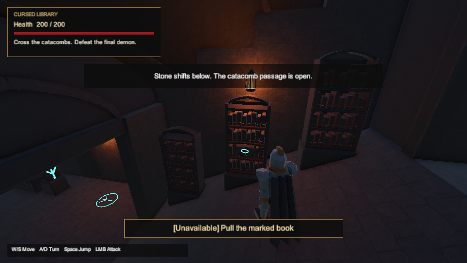
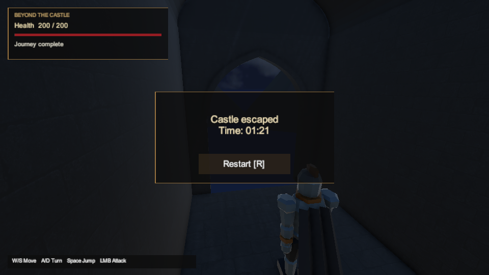

# Primary castle completion candidate — 2026-10-08

The candidate targets the authored `Assets/Scenes/ForsakenCastle.unity` in Unity **6000.6.3f1**, with the existing package pins. Engine and player inputs are committed as `5af8861c39bd5fbf4d324690e5a74b1d12aae333`. The separate historical `ForsakenRuntimeCastle` remains available; its older build and timing reports do not describe this player.

The DOCX paragraphs and all six embedded images were inspected, including the four visual references, flow chart and map. Its SHA-256 remains `9baa88bd8a9c26fc6adcbcdc9032266096716a7475969c5a6d793356cf15ed31`. The adopted route and optional branch remain those in [design decisions](../design-decisions.md) and [the contract](../level-contract.json): courtyard → first demon → western rune lever and lower junction → throne miniboss → mandatory library → catacombs → final demon → exit. The catacomb lever, bonus relic and concealed throne return remain optional.

## Changes and source boundaries

Fresh rendered evidence exposed two unfinished presentation details. DOCX §4's cult trace was a solid glowing square; it now uses an enclosing ring and branching glyph. DOCX §7's terminal view faced a blank wall; it now has a pointed stone opening toward the existing night sky. The glyph and opening are implementation choices, rather than additional shapes specified by the DOCX.

Only two existing mesh assets were regenerated. Their `.meta` files and GUIDs, saved scene, physical collision, navigation, enemy balance and progression rules are unchanged. The original end-wall collider remains beyond the terminal threshold. The explicit targeted authoring method discards its temporary additive scene without saving it. An independent source review identified an omitted top face; the final mesh includes that cap and a saved-triangle regression.

The route capture tool now warms its render destination, synchronously resolves emissive material passes and checks compiler readiness before saving the same gameplay state. It restores the previous compilation and rendering settings. The first attempt's magenta torch/window placeholders remain in local evidence; later captures show the intended warm torch and stained-glass colors. The transient first-use explanation is supported by the before/after rendering and identical material properties, rather than a demonstrated runtime material defect. [Unity's shader compilation API](https://docs.unity3d.com/6000.0/Documentation/ScriptReference/ShaderUtil.CompilePass.html) documents the synchronous pass option.

## Verification

| Evidence category | Result | Retained evidence |
| --- | --- | --- |
| DOCX/contract model | Passed; 29 states without secret / 63 with it | `artifacts/goal-20261008/baseline/level-contract.log` |
| Python tooling | 147/147 passed in WSL, 10.889 s, no failures/skips | `artifacts/goal-20261008/final-tooling/python-tests.log` |
| Unity source integrity | Passed; 325 assets / 369 unique GUIDs | `artifacts/goal-20261008/final-tooling/source-integrity.log` |
| Headless C# | Retained 186/186 passed; all 34 compiled/project/contract input blobs unchanged at this candidate | `artifacts/goal-20261008/headless-input-reuse.json` |
| Unity EditMode | 187/187 passed at the committed candidate, no failed/skipped cases, process exit 0 | `artifacts/goal-20261008/committed-editmode/` |
| Unity PlayMode | Full run 227/228; unchanged affected case passed 1/1 in focused retry; no skipped cases | `artifacts/goal-20261008/committed-playmode/` and `committed-throne-retry/` |
| Windows x64 player | Build succeeded; exit 0, 0 errors / 0 warnings, 199 engine files / 133,842,184 bytes | `artifacts/goal-20261008/committed-build/` |
| Native startup | Headless Windows startup observed; normal WM_CLOSE / exit 0, identity unchanged, no flagged log errors | `artifacts/goal-20261008/committed-build/startup-headless/` |
| Standalone routes and timing | First human basic-route attempt retained incomplete; timing input rejected. Automation setup retains a normal no-input exit and a prelaunch extraction failure; fresh player launched, input stopped at confirmed lock screen | See remaining acceptance below |

The seven .NET suite counts are Progression 29, Movement 36, Camera 32, Combat 60, Interactions 17, Performance 7 and Puzzles 5. Their retained execution belongs to baseline `ac28944`; the reuse report verifies unchanged Git input blobs, TRX hashes and counters. Windows CRLF checkout bytes and the final LF checkout are identified separately. These tests compile shared core sources, not MonoBehaviour.

The full PlayMode run took 650.062 s runner time / 633.5462359 s XML time and exited 2. Its sole failed case, `CastleThroneFightDeathRestartsTheSavedWorld`, caught an unhandled FMOD output-device initialization error immediately after Unity logged a default audio-device change. The unchanged, audio-enabled focused retry passed 1/1 and exited 0 after 80.015 s runner / 62.7883791 s XML time. All 228 unique cases have passing execution across these two runs; this is **not a clean 228/228 full-suite pass**. No source, assertion, deadline, audio-disabling flag or host audio setting was changed for the retry. The exact reason for the host device change remains unproven.

The current primary controls-driven routes finished in **81.511650 s without the secret** and **121.431679 s with the secret**, each with 200 HP. Both use the main authored scene, require all three fights and restart through the terminal R action. These are known-route editor measurements, rather than standalone or first-attempt human timings.

Engine execution uses a retained isolated verification cache and a separate exact-byte LF source checkout. It is not a clean cold import. Each run retains its command, runner, native source hashes, XML, editor log and importer deltas. Actual rendering remains enabled and no audio-disabling flag is supplied; the FMOD fallback above prevents claiming reliable audible output. The temporary runner power request is released when Unity exits. Failed sandbox/environment attempts are preserved separately. The build runner additionally records every actual native pre-build file, including the retained generated `SceneTemplateSettings.json`, separately from the 722 committed input hashes.

## Windows player identity

The primary-only `CastlePlayerBuild.BuildForBatch` succeeded with Unity's logged duration **00:02:14.9191971** and **150.375 s** total runner time. The pinned editor path is explicit in the retained Hub CLI command. A separate exact-byte LF checkout supplies the 722 committed native inputs; all 723 actual pre-build files are recorded, including the generated scene-template settings. The post-build archive and engine inventory are frozen before any startup observation.

All **19 exact source/imported pairs** were reviewed and accepted by the official manifest validator, with **0 unreviewed pairs / 0 unresolved findings**. The [retained review](docx-completion-2026-10-08/build-import-review.json) identifies each pair and reason. Thirteen materials add URP version metadata/formatting while preserving their material bodies. The other changes are pinned-package default fields, missing disabled volume-reference cleanup, editor-only build-generated shader prefilter data, existing graphics-settings references selected for runtime, formatting and the generated scene-template defaults. Code, authored scene, physical navigation and authored runtime settings remain unchanged. Detailed package-source excerpts and exact normalization checks remain in local `identity/import-review-analysis.json`.

The verified ZIP is available locally at `Builds/ShadowsOfTheForsaken-Windows-x64-20261008.zip` (**44,482,497 bytes**, 200 entries including the additional receipt). CRC, entry paths, sizes and every SHA-256 were checked against the frozen player. The delivery copy has the same hash. Extract all files together and launch `ShadowsOfTheForsaken.exe`; W/S moves, A/D turns, Space jumps, LMB attacks, E interacts and R restarts from a terminal screen. The [primary-player playtest handoff](../primary-player-playtest.md) enables observation, preserves distinct attempts and verifies the player before and after play; the owner lifted the foreground-testing deferral on 2026-10-14.

| Identity | SHA-256 |
| --- | --- |
| Windows ZIP | `3c328a9382826bce0c1090fb164f09e6b572d04d6c03fd408e2a520409b71984` |
| BUILD-INFO receipt | `aa3fbf3c43943579fafe956a8fba43c5348232d3d48ef22f81b8eaa0e6a93578` |
| Committed native archive | `fc953c3d4e8f7c4554fc4d14451891f3eec2cce3706e2dd84d9c481efb3ecb80` |
| Post-build imported archive | `a20f83bbb0b9d2d3e3e09ffcc1cf15ddfc09a95710f9189b37f9c76959ff1bf9` |
| Approved import review | `beea418eb3935f1525a3dbb2ea012056fafaffefd15cfd4c7dd6a9c0eefa7b94` |

The opt-in observer then confirmed a stable native startup in **Running / Courtyard**, no objective flags, 200/200 player HP and three full-health dormant enemies. It ran in **headless batch mode**, with D3D11 requested and no audio-disabling flag. No focus activation, gameplay input, time/progression modification or screenshot was performed. Only windows owned by spawned PID 35312 received WM_CLOSE; the process exited **0**, a normal-exit observer event was retained, no forced termination was used and the complete player identity verified unchanged afterwards. No error candidates were flagged in its log. This checks native loading and initial state, rather than foreground graphics, audible output, traversal, pacing or performance.

[The machine-readable validation summary](docx-completion-2026-10-08/validation-summary.json) binds the source, logs, test XML, gallery, import review, package and startup receipts. Engine inputs belong to `5af8861`; the following documentation/gallery commit does not change native inputs.

## Rendered evidence

These are actual primary-scene camera/HUD frames from `committed-playmode`, copied without image edits. [The screenshot manifest](docx-completion-2026-10-08/screenshot-manifest.json) records every original path, SHA-256, size and dimensions, plus the run's source, execution and XML receipts. The full run's audio-related failure remains recorded alongside these images.

| DOCX connection | Actual frame |
| --- | --- |
| §§2–3/7: calm castle introduction | [Courtyard](docx-completion-2026-10-08/01-courtyard.png) |
| §§3/6: single initial threat | [First fight](docx-completion-2026-10-08/02-first-fight.png) |
| §§3/8: marked lever and lower backtracking | [Rune lever](docx-completion-2026-10-08/03-rune-lever.png) |
| §§4/6: throne-room miniboss | [Throne fight](docx-completion-2026-10-08/04-throne-miniboss.png) |
| §4: forbidden books and concealed passage | [Library and cult inscription](docx-completion-2026-10-08/05-library.png) |
| §§4/8: lower cult/burial network | [Catacombs](docx-completion-2026-10-08/06-catacombs.png) |
| §§6/8: required final fight | [Final demon](docx-completion-2026-10-08/07-final-fight.png) |
| §7: exit and terminal completion | [Pointed exit](docx-completion-2026-10-08/08-complete-main.png) |
| §§6/8: optional upper branch | [Relic room](docx-completion-2026-10-08/09-optional-relic.png) |

## Remaining acceptance

The previous owner instruction to continue implementation and defer standalone foreground/OS-input checks remains historical context in [the acceptance matrix](../docx-acceptance.md). On **2026-10-14**, the owner authorized a human playtest and confirmed this is their first time playing. The `human / first_attempt / basic` attempt in `artifacts/primary-player-playtest/attempt-6e914f6fd871408794a570e817ea79c7` exited normally with code 0 at `06:23:06.5409484Z`, with player identity verified unchanged. It remained **incomplete**: Running / Puzzle, first enemy defeated and main puzzle solved, 176 HP, 210.978 s elapsed. That is not a completion time. The owner did not supply an interruption declaration; the assistant recorded `unknown` with explicit provenance. The preserved `timing-review.json` returned 1, rejected the absent uninterrupted-run declaration and counted zero completed human runs. Its SHA-256 is `0ab531dbe25138643126049871b3a6ebefd07850fae2dd8f5d4c62e0789778b2`.

The human log contains seven `CameraFollow` safety events reporting rendering suspended until recovery. They are unlocated and untimed; no lasting visible defect is established. The unavailable DOF/Panini shader messages concern unused post-process passes, and no audio errors were found in the inspected log. Neither finding supplies visual/audio acceptance.

The owner then requested computer-use autoplay. The setup automation kit `attempt-3093873a892e41b7bb75450b52086be4` exited normally without gameplay input, and a later PTY extraction failed before launch with its partial kit retained. A fresh `automation / known_route / basic` player launched with kit `artifacts/primary-player-playtest/attempt-d2721934e31742688d88c52ef4a2af1c`. The desktop capture and read-only process query confirm the Windows lock screen; computer-use input is stopped pending owner unlock. No autoplay gameplay has executed. The [standalone report](standalone-playtest-2026-10-14.md) links actual human receipts, timing refusal and setup launch records with exact hashes. No completion, timing, audio or performance acceptance is claimed. Human first-attempt exploration, combat and clue readability, visual/audio approval, three basic standalone timing runs plus a secret run, standalone death/restart and full-route hardware performance remain open. Automation is reported separately and does not establish the DOCX's 2–3 minute human pacing target.

The latest inspected main Unity CI run, [37580577661](https://github.com/lisu188/shadows-of-the-forsaken/actions/runs/37580577661), failed its activation prerequisite and skipped engine tests. Main's Python/C# workflows passed. This describes `ac28944`, not a new remote run of the candidate; local engine results are separate evidence.
