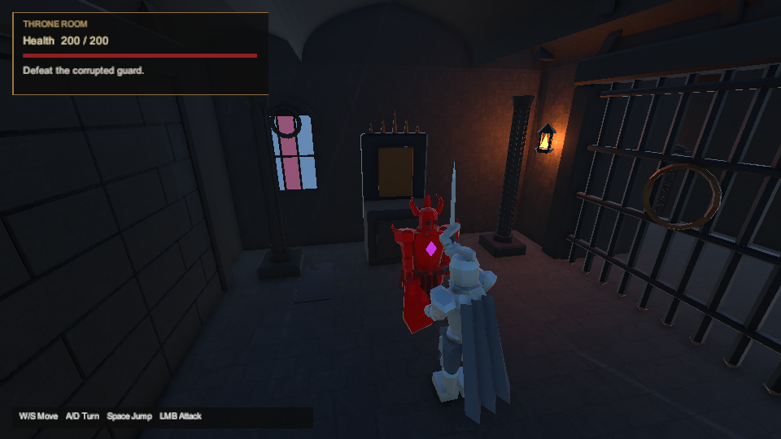
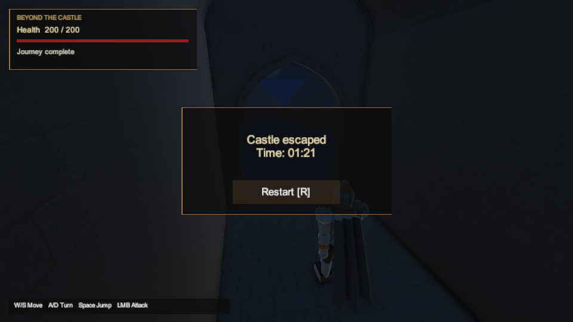

# Hidden Unity route verification — 2026-10-14

The owner selected **“Hidden Unity route test”**. The saved primary `ForsakenCastle` fixture passed **10/10 cases** in Unity **6000.6.3f1**: six gameplay cases and four framing-ray helpers, with no failed, skipped or inconclusive cases. The process exited **0**, no runner stop condition fired, and the temporary power request was restored. Runner time was **475.171 s**; NUnit suite time was **431.6823245 s**.

This is a filtered **Unity Editor PlayMode** run in hidden batch mode, with graphics and audio requested enabled and no `-nographics` or `-disableaudio` flag. The fixture supplies Input System keyboard/mouse events and focus callbacks; it does not use OS input or ComputerUse. It is neither a standalone player test nor a first-attempt human playthrough.

## DOCX coverage and results

DOCX §3's calm introduction, single first threat and rune mechanism, §4's throne/library/catacomb progression, and §§6–8's mandatory fights, lower backtracking, optional branch and exit are exercised in the saved primary scene. The [adopted design decisions](../design-decisions.md) remain unchanged.

| Exact gameplay case | Result |
| --- | --- |
| `CastleMainRouteCompletesThroughControlsWithoutSecret` | Passed; all mandatory objectives and living-player exit, then terminal-R world reset |
| `CastleSecretRouteReturnsThroughThroneAndStillRequiresFinalFight` | Passed; relic and throne return, mandatory final fight and exit, then terminal-R reset |
| `CastleFirstFightDeathRestartsTheSavedWorld` | Passed; enemy-inflicted death and saved-world reset |
| `CastleThroneFightDeathRestartsTheSavedWorld` | Passed; enemy-inflicted death and saved-world reset |
| `CastleFinalFightDeathRestartsTheSavedWorld` | Passed; enemy-inflicted death and saved-world reset |
| `CastleLockedMainGatesRejectWalkingAndJumping` | Passed; locked gates reject walking/jumping |

All use the `ShadowsOfTheForsaken.Tests.PlayMode.FullCastleRouteTests` fixture. Its four additional helper cases passed: nearest-surface ray selection with both Boolean variants, backface/exclusive-distance behavior, and misses inside/outside mesh bounds. These helpers are not four additional level traversals.

The two completed input traces end at Exit with **200 HP**: **81.756554 s basic** and **121.097183 s secret**. The basic trace contains only mandatory objectives; the secret trace includes the bonus room and throne return before the required final fight. These are known-route editor measurements, **not evidence for the DOCX's 120–180 second human pacing target**. The new run does not replace the earlier full 228-case report or erase its retained audio-related failure.

## Source and actual-input scope

The clean LF source checkout is exact commit `5af8861c39bd5fbf4d324690e5a74b1d12aae333`; all **722 committed native inputs** match their Git blob bytes. The runner copied those inputs into the retained isolated verification project and froze its own source, command, copied-input hashes and execution record. It reused the import cache; **no cold-import claim is made**.

Fresh required checks also passed: unchanged DOCX/contract (29 states without the secret / 63 with it), **147/147 Python tests** in WSL (10.449 s), Unity project integrity (325 assets / 369 GUIDs), and **29/29 real Progression .NET tests**, with no failed/skipped cases. The [source-check summary](../../artifacts/goal-20261014/source-checks/summary.json) binds the logs/TRX and unchanged native/tooling inputs. This is 29 fresh .NET cases, not a fresh execution of all 186 retained core cases.

The runner records copied paths, rather than every possible actual native file. Supplementary inventories observed **725 files during execution** and **723 after termination**. The two temporary `InitTestScene…unity` / `.meta` bootstrap files were created and removed by the pinned Unity Test Framework. These observations do **not reconstruct a complete actual-byte prelaunch map** or establish complete actual-native pre/post byte identity.

All **44 exact source/after differences** were reviewed, with **0 unreviewed pairs / 0 unresolved findings**: 43 changed tracked files plus the previously reviewed generated `SceneTemplateSettings.json`; no committed input was removed. The review explains 12 materials adding only editor version metadata/formatting, Rune serializing pinned Lit defaults and derived motion-vector state, 28 materials changing only obsolete `_Color` compatibility roundoff (maximum absolute change at most `1.1e-7`, with `_BaseColor` and emission unchanged), two whitespace-only settings files, and the generated scene-template defaults. Main source, authored scene, script/meta GUIDs, packages and gameplay rules remain unchanged. These cache transformations are separate from the existing Windows player's build receipt.

The [supplementary verification](../../artifacts/goal-20261014/hidden-routes/filtered-verification.json) independently checks exact XML names/counters, both input traces, 39 structurally valid 960×540 PNGs, nine framing JSONs and their hashes. The [post-import review](../../artifacts/goal-20261014/hidden-routes/post-import-review.json) retains exact pairs, diffs and pinned-package code evidence.

| Evidence | SHA-256 |
| --- | --- |
| [Execution receipt](../../artifacts/goal-20261014/hidden-routes/execution.json) | `892d8d2f1402202ec291cdedea3ad872d44abbaa407f589a5a5237faf21a5aaf` |
| [NUnit XML](../../artifacts/goal-20261014/hidden-routes/results.xml) | `2b90ba09bcc9b6e52b722536b1f35ad7016b374a1d26a8b120943567b88c8e1f` |
| [Copied-source snapshot](../../artifacts/goal-20261014/hidden-routes/source-snapshot.json) | `e78727ad526e567730d7c7356c8b7cd8e5a52e5e348d189c47b58f16fec88e64` |
| [Filtered verification](../../artifacts/goal-20261014/hidden-routes/filtered-verification.json) | `8c3bc47b164aacdb6696078dd7a3a9743742a2bf9834a1890354fc26cbd4e2da` |
| [Exact post-import review](../../artifacts/goal-20261014/hidden-routes/post-import-review.json) | `1c9852c7a65f1c2a8054b9af0f7ed14d44ddb72f848d0e48d70b1fc454e94fc0` |
| [Fresh source/tooling/.NET checks](../../artifacts/goal-20261014/source-checks/summary.json) | `326551ad51ec27e06aa1f17099711cc68917942a8ffebb7025b1877155d79ffb` |
| [Screenshot manifest](hidden-routes-2026-10-14/screenshot-manifest.json) | `a7953fc0fcb4de745a9465260bf6eb7d85194845670f4c434cfd2a834c5e1f64` |

## Rendered editor evidence

These four PNGs are original-byte copies of actual fixture captures, bound to the source/execution/XML by the screenshot manifest. Git preserves this manifest's exact bytes so line-ending conversion cannot invalidate its recorded hash. The images show the saved camera and camera-space HUD during automated editor play; they do not supply human readability or standalone acceptance.

| DOCX connection | Capture |
| --- | --- |
| §§4/6: throne miniboss | [Main-route miniboss](hidden-routes-2026-10-14/01-main-miniboss.png) |
| §4: forbidden library and concealed gate | [Library before opening](hidden-routes-2026-10-14/02-library-sealed.png) |
| §§6/8: optional upper bonus branch | [Secret relic](hidden-routes-2026-10-14/03-secret-relic.png) |
| §§6–8: mandatory final fight and exit | [Main-route completion](hidden-routes-2026-10-14/04-main-complete.png) |

## Diagnostics and remaining acceptance

The complete editor log is retained. It has **no matching FMOD/device-reset/no-sound, native-crash or camera-safety messages** of the kinds seen in the earlier standalone attempts. Licensing validation/access-token refresh diagnostics, four `abort_threads` cleanup messages and a debugger-listen notice remain recorded. Exit 0 and passing XML do not turn this into a claim of an empty diagnostic log or positive audible-output acceptance.

The owner separately answered **“no”** when asked whether they had noticed view flicker/disappearance or missing audio during the earlier incomplete human attempt. The [limited feedback receipt](../../artifacts/primary-player-playtest/attempt-6e914f6fd871408794a570e817ea79c7/human-feedback-20261014.json) has SHA-256 `edb9e29a79d4194c10847adf23b143add5e10500a9b492b2d90034d61bf7ae8d`. This concerns that participant's partial experience only; it does not establish audible output throughout the level, full-route visual approval or pacing. The [standalone report](standalone-playtest-2026-10-14.md) preserves the incomplete human attempt and d272's separate native-crash/audio diagnostics and unqualified external movement.

Standalone OS-input routes, three basic and one secret human timing runs, completed first-attempt feedback, audio/visual approval and whole-route hardware performance remain open under the [acceptance matrix](../docx-acceptance.md). This filtered editor pass is not the full 228-case suite, a new player build, a cold import or final DOCX acceptance.
